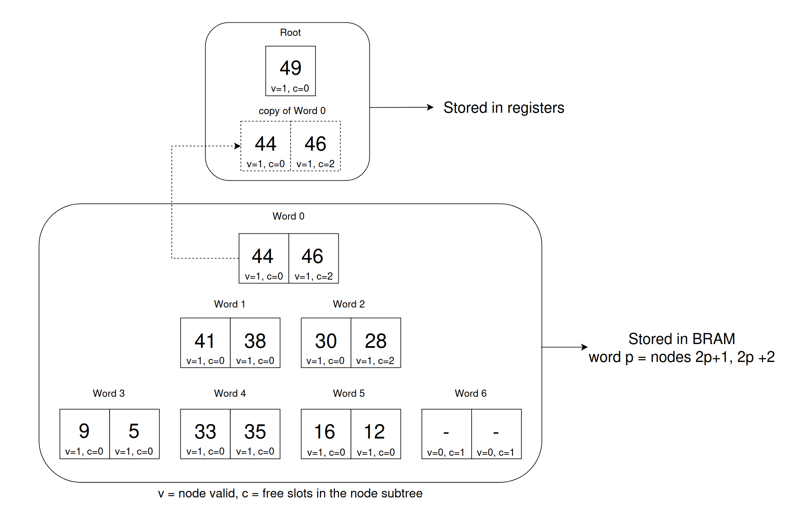

# BRAM Tree (Pair)

## Description

The pair BRAM-tree is a variant of the flat BRAM-tree that stores each pair of sibling nodes in a single BRAM word. Pair $p$ holds nodes $2p + 1$ and $2p + 2$, the two children of node $p$, so one read returns both candidates for a compare-and-swap and one write stores the result. The root is kept in a register, and the root's two children are mirrored in registers, so a new command decides the first level of the tree in the same cycle it arrives.

Each node carries a valid bit and the number of free slots in its subtree, which lets an enqueue walk directly toward free space. Every step of a walk reads one pair, compares and writes it back, moving one level per clock cycle. As a result, an operation takes at most $log_2(N+1)$ cycles, about half the cycles of the flat BRAM-tree, while the whole queue still occupies a single simple dual-port BRAM. Because the RAM has no reset port, both readies stay low after reset while the tree is refilled with empty nodes, one pair per cycle.

## Structure

