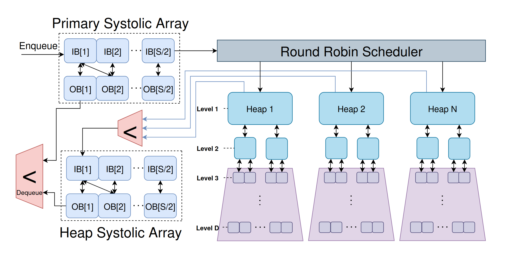

# Hybrid Systolic BRAM Heap

## Description

The hybrid systolic BRAM heap combines two systolic arrays with a bank of BRAM-trees. A main systolic buffer accepts every enqueue at one per cycle. When it is full, its lowest-priority element spills into one of the BRAM-trees, chosen a cycle ahead in rotation among trees that are ready and not full. A second systolic buffer, the heap buffer, collects tree roots: when it has room it pulls the largest root, selected by a max tree over the registered tree roots, and when it is full but a tree root outranks its head, the two are swapped, so a full buffer never hides the maximum. The head of the queue is the larger of the two buffer heads.

Each tree is `bram_tree_for_hybrid`, a pair BRAM tree like the library's `bram_tree`, reset by one block shared by every tree. Because spills and pulls are spread across many trees, several trees can rebalance at once, which hides the latency of individual BRAM accesses: an enqueue completes in one cycle, while a dequeue or replace waits only when it needs a root that is still settling. The architecture is sized by macros rather than parameters: `HYBRID_SYSTOLIC_QUEUE_SIZE`, `HYBRID_TREE_COUNT` and `HYBRID_BRAM_TREE_QUEUE_SIZE` (which must be $2^k - 1$), for a total capacity of $T \times N + 2 \times (S - 2)$ for $T$ trees of $N$ nodes and buffers of $S$ entries.

## Structure

