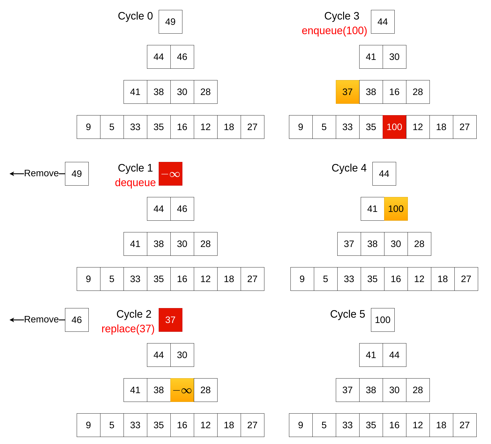
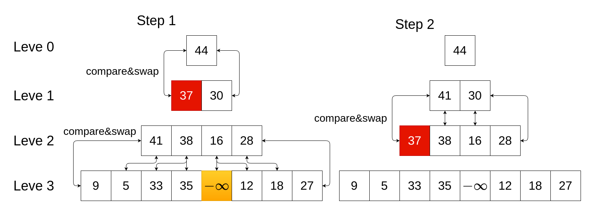
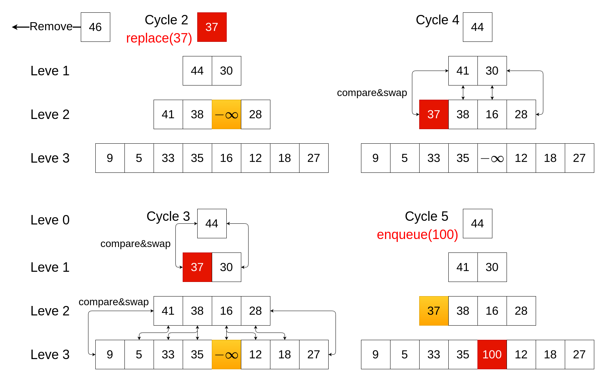

# Register Tree (Pipelined)

## Description

This is a pipelined version of the register tree architecture that divides the compare-and-swap logic between cycles, reducing the logic circuit burden during synthesis and achieving a faster clock frequency.

## Dataflow

In the standard register tree, each cycle sifts two levels. After a dequeue or replace the root outranks every other node within one cycle, so the next read can start while the sink continues below it; a write waits for the sink or climb to reach the bottom of the tree.

A detailed view of the compare-and-swap operation occurring between cycle 2 and cycle 3.

Illustration of how data flows in cycle-based operation after pipelining. The pipelined tree sifts one level per cycle. Its read side reopens two cycles after a dequeue or replace, and a write waits about one cycle per level.

## Performance comparison against non-pipelined

